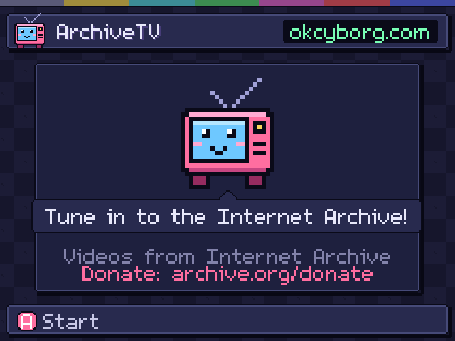
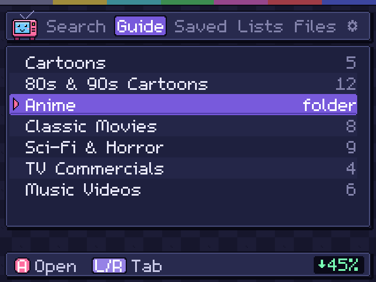
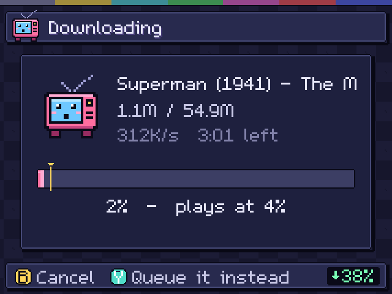

# ArchiveTV

A cute little TV for your Miyoo Mini. Browse, stream and download videos from the
[Internet Archive](https://archive.org) on Onion OS.

  

- **Search** videos and collections, with recent searches kept
- **Guide**: hand-picked shelves of cartoons, 80s & 90s anime, movies and more (edit `guide.txt`)
- **Watch now**: starts playing after a few percent, keeps downloading as you watch
- **Download queue** with pause, resume and partial downloads that survive Wi-Fi drops
- **Saved** shows and searches, **playlists**, resume where you stopped
- Four themes (Night by default), scanlines, menu music and sounds

## Devices

One build for the whole SSD202D Miyoo family on **Onion OS 4.2+**:

| Device | Screen |
| --- | --- |
| Miyoo Mini v1–v3, Mini Plus | 640×480 |
| Miyoo Mini v4, Mini Flip | 752×560 |

Browsing and downloading need Wi-Fi (Mini Plus, Mini Flip). Models without Wi-Fi play
videos copied into `App/ArchiveTV/videos`.

## Install

Download `ArchiveTV-vX.Y.zip` from [Releases](../../releases), copy its `App` folder to the
root of your SD card (merge folders), and open **ArchiveTV** from Apps.
It's also listed in [Mixtape](https://github.com/snyderman3000/mixtape).

## Controls

| Button | Menus | Playing |
| --- | --- | --- |
| D-pad | move, left/right = page | left/right ±10 s, up/down ±1 min |
| A | open / menu | pause |
| B | back | stop |
| START | do it now (play, search, open) | pause |
| Y | save to Saved | show/hide time bar |
| X | tap: delete / sort; hold: scroll long titles | screen off/on |
| L1 / R1 | switch tab | ±1 min |
| L2 / R2 | | ±5 min |
| SELECT | change theme | start over |
| MENU | turn ArchiveTV off | stop |

## How it works

`archivetv` is a single C program on SDL 1.2. It plays video with the FFmpeg 2.4 libraries
and fetches everything with the `curl` that ship with Onion OS, so the app bundles neither.

### Building

Needs `clang`, `lld` and `llvm` tools; no Miyoo SDK.

```sh
mkdir libs
cp /Volumes/MIYOO/.tmp_update/lib/parasyte/{libavcodec.so.56,libavformat.so.56,libavutil.so.54,libswresample.so.1} libs/
sh build.sh            # -> build/archivetv
cp build/archivetv App/ArchiveTV/
```

## Credits

- Made by [@0kCyb0rg](https://x.com/0kCyb0rg) · [okcyborg.com](https://okcyborg.com)
- Music: "Select a Level" by @0kCyb0rg · menu sounds by @0kCyb0rg
- Font: [m5x7](https://managore.itch.io/m5x7) by Daniel Linssen
- Video playback: [FFmpeg](https://ffmpeg.org) · downloads: [curl](https://curl.se) (both from Onion OS)
- Videos: the Internet Archive. Please [donate](https://archive.org/donate).

Code is MIT licensed; the music and sounds are not (see [LICENSE](LICENSE)).
